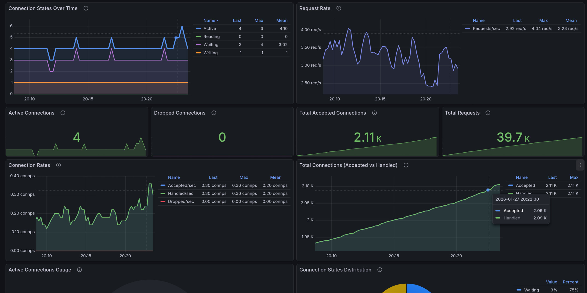

# Nginx Prometheus Metrics Exporter

Экспортер метрик Nginx в формате Prometheus, использующий njs (Nginx JavaScript) для сбора данных из `stub_status`.



## Описание

Проект предоставляет endpoint `/v1/metrics` с метриками Nginx в формате Prometheus.

Метрики собираются из встроенного модуля `stub_status` через njs скрипты.

Файл дашборда для Grafana - dashboars.json

## Метрики

Проект экспортирует следующие метрики:

### Gauge метрики (текущие значения)

- `nginx_connections_active` - Активные клиентские соединения
- `nginx_connections_reading` - Соединения, где nginx читает заголовок запроса
- `nginx_connections_writing` - Соединения, где nginx отправляет ответ клиенту
- `nginx_connections_waiting` - Простаивающие соединения, ожидающие запрос

### Counter метрики (накопительные счетчики)

- `nginx_connections_accepted_total` - Общее количество принятых соединений
- `nginx_connections_handled_total` - Общее количество обработанных соединений
- `nginx_requests_total` - Общее количество запросов
- `nginx_connections_dropped_total` - Общее количество отброшенных соединений (accepted - handled)

Все метрики содержат метку `instance` с именем хоста.

## Требования

- Или Nginx с модулем `ngx_http_js_module` и `ngx_http_stub_status_module` (для установки без Docker)

## Быстрый старт

### Сборка Docker образа

```bash
docker build -t nginx-prometheus-metrics .
```

### Запуск контейнера

```bash
docker run --rm --name nginx-metrics-test -p 8000:80 nginx-prometheus-metrics
```

### Проверка работы

Проверка основного endpoint:
```bash
curl http://localhost:8000/
```

Получение метрик Prometheus:
```bash
curl http://localhost:8000/v1/metrics
```

Проверка stub_status (внутренний endpoint):
```bash
curl http://localhost:8000/v1/stub_status
```

## Конфигурация

### Nginx конфигурация

Основные настройки в `nginx.conf`:

- `js_path "/etc/nginx/src/"` - путь к njs скриптам
- `js_import metrics from metrics.js` - импорт модуля метрик
- `location /v1/metrics` - endpoint для Prometheus метрик
- `location /v1/stub_status` - внутренний endpoint для stub_status

### Настройка меток

Метка `instance` автоматически берется из переменных nginx:
- `r.variables.hostname`
- `r.variables.host`
- Или `'unknown'` если переменные не установлены

## Использование с Prometheus

Добавьте в `prometheus.yml`:

```yaml
scrape_configs:
  - job_name: 'nginx'
    static_configs:
      - targets: ['localhost:8000']
    metrics_path: '/v1/metrics'
```

## Пример вывода метрик

```prometheus
# HELP nginx_connections_active Active client connections
# TYPE nginx_connections_active gauge
nginx_connections_active{instance="localhost"} 1

# HELP nginx_connections_reading Connections where nginx is reading the request header
# TYPE nginx_connections_reading gauge
nginx_connections_reading{instance="localhost"} 0

# HELP nginx_connections_writing Connections where nginx is writing the response back to the client
# TYPE nginx_connections_writing gauge
nginx_connections_writing{instance="localhost"} 1

# HELP nginx_connections_waiting Idle client connections waiting for a request
# TYPE nginx_connections_waiting gauge
nginx_connections_waiting{instance="localhost"} 0

# HELP nginx_connections_accepted_total Total number of accepted client connections
# TYPE nginx_connections_accepted_total counter
nginx_connections_accepted_total{instance="localhost"} 12345

# HELP nginx_connections_handled_total Total number of handled connections
# TYPE nginx_connections_handled_total counter
nginx_connections_handled_total{instance="localhost"} 12345

# HELP nginx_requests_total Total number of client requests
# TYPE nginx_requests_total counter
nginx_requests_total{instance="localhost"} 67890

# HELP nginx_connections_dropped_total Total number of dropped connections (accepted - handled)
# TYPE nginx_connections_dropped_total counter
nginx_connections_dropped_total{instance="localhost"} 0
```

## Лицензия

Проект предоставляется "как есть" для использования и модификации.
