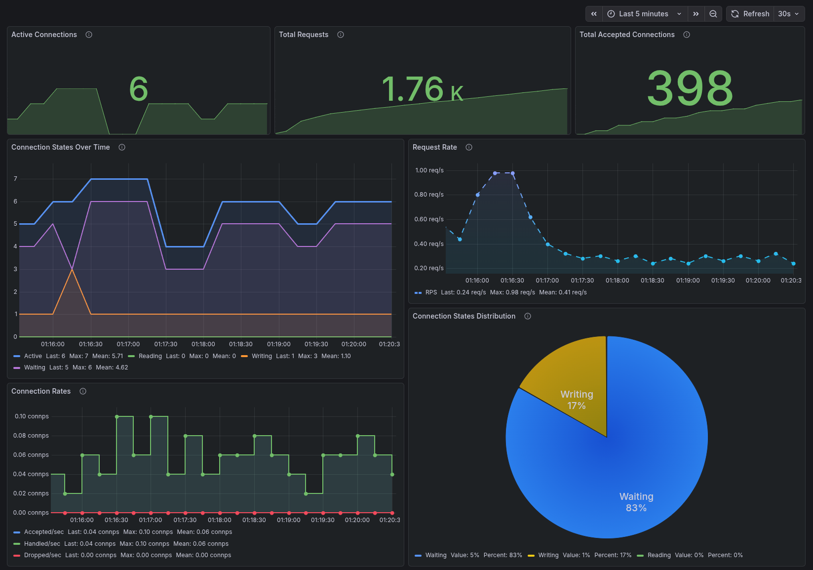

# Nginx Prometheus Metrics Exporter

Экспортер метрик nginx в формате Prometheus на njs (nginx JavaScript).
Метрики берутся из встроенного модуля `stub_status`, отдаёт их сам nginx:
отдельный контейнер-экспортер не нужен.



## Что внутри

  * `src/metrics.js` - обработчик `js_content`: subrequest к `stub_status`, разбор ответа, вывод метрик.
  * `src/prometheus.js` - минимальный модуль формата экспозиции Prometheus.
  * `nginx/nginx.conf` - тестовая конфигурация для Docker-образа.
  * `dashboard.json` - дашборд для Grafana.
  * `bin/build`, `bin/start`, `bin/check` - сборка, запуск и проверка образа.

## Метрики

### Gauge (текущие значения)

- `nginx_connections_active` - активные клиентские соединения
- `nginx_connections_reading` - nginx читает заголовок запроса
- `nginx_connections_writing` - nginx отправляет ответ клиенту
- `nginx_connections_waiting` - простаивающие keep-alive соединения

### Counter (с момента запуска nginx)

- `nginx_connections_accepted_total` - принятые соединения
- `nginx_connections_handled_total` - обработанные соединения
- `nginx_connections_dropped_total` - отброшенные соединения, `accepted - handled`
- `nginx_requests_total` - запросы

Меток у метрик нет: `job` и `instance` Prometheus добавляет сам при сборе.

## Требования

- nginx с модулем `ngx_http_stub_status_module`.
- Модуль njs (`ngx_http_js_module`) версии 0.7.0 или новее: код использует async/await.
- Docker - только для тестового образа.

Официальный образ `nginx:1.29-alpine` уже содержит njs, ставить отдельно ничего не нужно.

## Быстрый старт

```bash
bash bin/build    # собрать образ nginx-prometheus-metrics
bash bin/start    # запустить на 127.0.0.1:8000
```

Проверка:

```bash
curl http://127.0.0.1:8000/                  # nginx поднялся
curl http://127.0.0.1:8000/metrics           # метрики Prometheus
curl -I http://127.0.0.1:8000/stub_status    # 404: снаружи закрыт
```

`bash bin/check` делает то же самое автоматически: собирает образ, поднимает
контейнер, проверяет метрики и недоступность `stub_status`, удаляет контейнер.

## Подключение к существующему nginx

1. Скопировать `src/metrics.js` и `src/prometheus.js` в один каталог,
   например `/etc/nginx/src/`. Файлы должны лежать рядом: `metrics.js`
   импортирует `./prometheus.js`.

2. Добавить в конфиг. `js_import` можно объявить на уровне `http`, тогда
   `js_content metrics` доступен в любом `server`:

```nginx
load_module modules/ngx_http_js_module.so;

http {
  js_path "/etc/nginx/src/";
  js_import metrics from metrics.js;

  server {
    # ...

    # Метрики. Снаружи закрыть: basic auth или allow/deny
    location = /metrics {
      auth_basic "metrics";
      auth_basic_user_file /etc/nginx/.metrics.htpasswd;
      access_log off;
      js_content metrics;
    }

    # Источник для subrequest из metrics.js. internal: снаружи недоступен,
    # subrequest из njs - внутренний запрос, ему internal не мешает
    location = /stub_status {
      internal;
      stub_status;
      access_log off;
    }
  }
}
```

Путь `/stub_status` задан константой `STUB_STATUS_URI` в начале `metrics.js`.

3. Добавить цель в Prometheus:

```yaml
scrape_configs:
  - job_name: nginx
    metrics_path: /metrics
    basic_auth:
      username: ...
      password: ...
    static_configs:
      - targets: ['nginx.example.com']
```

## Дашборд Grafana

`dashboard.json` импортируется через Dashboards, New, Import.

Переменные: `datasource` - источник Prometheus, `job` - значение `job_name`
из конфига Prometheus, можно выбрать несколько. Скорости считаются через
`$__rate_interval`, подходит для любого `scrape_interval`.

## Пример вывода

```prometheus
# HELP nginx_connections_active Active client connections
# TYPE nginx_connections_active gauge
nginx_connections_active 1

# HELP nginx_connections_reading Connections where nginx is reading the request header
# TYPE nginx_connections_reading gauge
nginx_connections_reading 0

# HELP nginx_connections_writing Connections where nginx is writing the response back to the client
# TYPE nginx_connections_writing gauge
nginx_connections_writing 1

# HELP nginx_connections_waiting Idle client connections waiting for a request
# TYPE nginx_connections_waiting gauge
nginx_connections_waiting 0

# HELP nginx_connections_accepted_total Total number of accepted client connections
# TYPE nginx_connections_accepted_total counter
nginx_connections_accepted_total 12345

# HELP nginx_connections_handled_total Total number of handled connections
# TYPE nginx_connections_handled_total counter
nginx_connections_handled_total 12345

# HELP nginx_requests_total Total number of client requests
# TYPE nginx_requests_total counter
nginx_requests_total 67890

# HELP nginx_connections_dropped_total Total number of dropped connections (accepted - handled)
# TYPE nginx_connections_dropped_total counter
nginx_connections_dropped_total 0
```

## Лицензия

MIT, см. [LICENSE](LICENSE).
